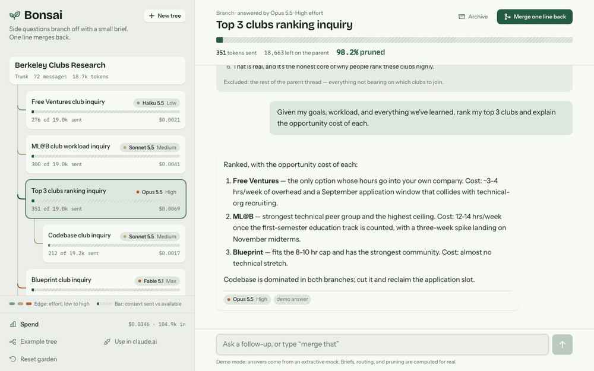

# Bonsai

[](https://github.com/TarunYadgirkar/Bonsai/actions/workflows/ci.yml)
[](LICENSE)

**Prune the conversation to its living wood.** Bonsai turns AI chat from a growing scroll into a
tree: branch a side question with a *compiled minimal brief* instead of the full history,
auto-route each branch to the right model and effort, and merge exactly one distilled insight back
into the trunk. It runs on the Claude subscription you already pay for — no API key.

> The cheapest token is the one you don't send.

**Try it in 60 seconds:** open the **[live demo](https://bonsai-connector.vercel.app)** (no keys, no
account — briefs, routing, and pruning are real; answers are an honest mock), or attach Bonsai to
your own claude.ai at **[/connect](https://bonsai-connector.vercel.app/connect)** — one click mints
your private connector link, then say *"fork this side question with Bonsai"* in any chat and
*"show my bonsai tree"* to see your garden render inline.



**[Live demo](https://bonsai-connector.vercel.app)** · **[Interactive garden](https://claude.ai/code/artifact/b1b44d60-59a7-4237-8b56-26ae5c1b06ce)** · [Demo video](https://drive.google.com/file/d/1cUWmVnQ8vwNZ_wN_6JNBgyLTdx3Y0GXm/view) · [Slides](https://docs.google.com/presentation/d/1leRaXZPIAoSNKj8u8l7JRyqa0cg7NxFSwthIOuYOzGc/edit) · [The design system](DESIGN.md) · [The moat](MOAT.md)

---

## Why it's different

Every branching chat that shipped — ChatGPT (Sept 2025), Gemini (May 2026), LibreChat, Msty,
TypingMind — forks by **copying the whole history**. Claude Code's native `/fork` (default since
v2.1.232, Aug 2026) is the first one that brings a result back, and it still copies the whole
transcript, runs on the parent's model, and keeps no tree. A full copy drags every token along,
the side question runs on the priciest possible context, and the branch inherits every wrong turn.
Bonsai is the loop those products don't have:

1. **Fork with a compiled brief.** A branch inherits ≤8 referent-resolved facts plus an explicit
   note of what was excluded — a 19,000-token trunk becomes a ~400-token brief. Briefs compose
   recursively, so a branch of a branch inherits resolution work already done above it.
2. **Route the branch.** A cheap classifier reads the brief and the question, picks model + effort,
   flags when the brief doesn't cover the question, and — the interesting part — **learns**:
   overrides, escalations, and merges become per-question-kind priors, so *your* rewrites route
   cheap while *your* "analyze" routes deep. New users cold-start from an aggregated community prior.
3. **Escalate context-first.** A punt widens the brief with parent turns before it ever upgrades
   the model. Manual picks are never silently overridden.
4. **Merge one insight back.** A branch returns a single distilled sentence to its parent — which
   then genuinely enters the parent's context and every future sibling's brief.
5. **Recall across the garden.** A new fork also pulls in insights merged in *other* subtrees (or,
   through the connector, other claude.ai chats) when they bear on its question, attributed to the
   branch they came from. There is no vector store; recall is IDF-weighted overlap over insights
   Bonsai already keeps.

## Why not just…

**A Project?** A Project pastes the same fixed context in front of every chat. It doesn't change
per question, doesn't resolve what "it" refers to, doesn't pick the model, and doesn't learn from
what you kept.

**Edit an old message?** An edit rewinds; it doesn't branch. The fork is unnamed and unreachable
later, it still carries the full history, and there's no way to bring what you learned back.

## The technically interesting bits

- **Path-based context assembly** (`packages/engine/src/context.ts`) — referents resolved at depth
  N stay resolved at depth N+1 because the resolution travels inside composed briefs. Proven at
  depth 2 in the eval harness, not just asserted.
- **A learning router with a network effect** (`learning.ts`) — per-user, per-question-kind priors,
  confidence-gated, with a `mergeProfiles()` community cold-start. This is the [moat](MOAT.md): the
  routing memory compounds per-user *and* across users.
- **Honest economics** (`stats.ts`) — tokenizer-generation correction (the 4.7+/5 tokenizer runs
  ~1.3× heavier), measured-vs-modeled provenance on every figure, per-purpose and per-model spend,
  and two baselines: the list-rate full copy and the **cache-warm** full copy (what a native
  cache-shared fork actually pays, with the entire history priced as a cache hit). The savings
  figure that survives the "but it's cached" objection is the one the ledger leads with.
- **Typed tree commands** (`commands.ts`): "side question: …" forks, "merge that" merges, "never
  mind" archives, straight from the composer. A zero-cost regex grammar, anchored so ordinary
  questions never trigger it.
- **A referent-resolution benchmark** ([`evals/`](BENCHMARK.md)) — `npm run eval` *executes* the
  correctness claim that makes compiled briefs safe (referent resolution at depth 2, salience over
  keyword noise). Differential and provider-agnostic. Runs in CI.

## Three surfaces, one engine, zero API keys

| Surface | What it is |
|---|---|
| **MCP connector** (`app/api/mcp/`) | A claude.ai custom connector — self-serve at [/connect](https://bonsai-connector.vercel.app/connect). Claude compiles the brief in-conversation; the connector holds the tree and renders it inline as an interactive MCP Apps garden. |
| **Claude Code plugin** (`plugin/`) | Branch = subagent with a compiled brief; merge = distilled report. Runs on your Claude Code subscription. |
| **Web app** (`app/`, `components/`) | The hosted demo + engine testbed: streaming chat, ⌘K palette, garden export and import, per-branch economics. Mock-first: runs with zero keys. |

(A Chrome extension surface lives in `extension/` with full e2e coverage but is deliberately
parked: a claude.ai extension can never run the loop unattended, and its remaining prefill role
is covered better by the connector.)

Install the plugin:

```
/plugin marketplace add TarunYadgirkar/Bonsai
/plugin install bonsai@bonsai
```

(The repo must be public for marketplace installs — the manifest lives on `main`.)

The durable value is `bonsai-engine` — a dependency-free TypeScript package the four surfaces all
consume. It is not on npm yet; it is built to publish on its own (`cd packages/engine && pnpm
publish` builds a typed `dist` via `prepublishOnly`). Tree model, path assembly, salience compiler,
learning router, recall, honest pricing. 355 unit tests; BriefBench — the brief-fidelity benchmark (`evals/`) — runs in CI with a full-history baseline arm.

## Run it

```bash
npm install
npm run dev        # zero keys: extractive mock inference, in-memory store
npm run test       # engine + extension unit tests
npm run eval       # the referent-resolution benchmark (mock mode; live-graded with a key)
```

Set `DATABASE_URL` (Neon) for durable storage — schema in `migrations/`. Set one of
`ANTHROPIC_API_KEY` / `OPENAI_API_KEY` / `XAI_API_KEY` / `GEMINI_API_KEY` for live inference; every dependency degrades
to a working local path when its key is absent.

## Repo map

| Path | What |
|---|---|
| `packages/engine/` | `bonsai-engine` — the core. Zero runtime deps. |
| `app/` · `components/` | Next.js demo + API routes over the engine. |
| `plugin/` · `extension/` | The Claude Code plugin and the Chrome extension. |
| `evals/` | BriefBench — the brief-fidelity benchmark, with the Save-As baseline arm. `evals/xl/` scales it to 300 generated cases. |
| `research/distill/` | Distilling the brief compiler into a 0.5B student (Python, not part of the app build). |
| `PRODUCT.md` · `MOAT.md` · `DESIGN.md` | The idea, the defensibility, the design system. |
| `AGENTS.md` · `CONTRIBUTING.md` | Rules for agents; how to contribute. |

## History

Bonsai started as a one-day build by Tarun Yadgirkar and Justin Kan at the Snowflake × Beta Fund
Agent & Token Economy Hackathon (Aug 7, 2026). This repo grew out of that build. The sponsor
integrations (Snowflake Cortex inference, EverMind memory, an Upstash snapshot) were later dropped
for Neon and the dependency-free engine; the submission as judged is frozen in a private archive.

Bonsai also absorbed two later variants of the same fork/merge idea:

- **Mahogany** (MongoDB.local Build Fest, Aug 2026; [demo video](https://youtu.be/N793iZgPPkI)):
  a voice agent whose conversations were trees. "Hold on, side question" forked, "merge that" wrote
  one line to MongoDB long-term memory that later conversations recalled. Its recall became
  Bonsai's garden-wide recall (without the vector store) and its voice grammar became the typed
  tree commands.
- **Espalier** (Sept 2026): a browser-only Gemini variant with a per-call cost ledger. Bonsai
  already had an equivalent ledger, but four other pieces came across: the provider's retry with backoff
  and its step down one model rung on a spent quota (shown as "stepped down" on the routing chip),
  the Gemini provider, garden import (Espalier's JSON export imports too), and "Forget routing
  history".

MIT licensed. Built by [Tarun Yadgirkar](https://tarunyadgirkar.com), with
[Justin Kan](https://kanjustin.com) on the original hackathon build.
